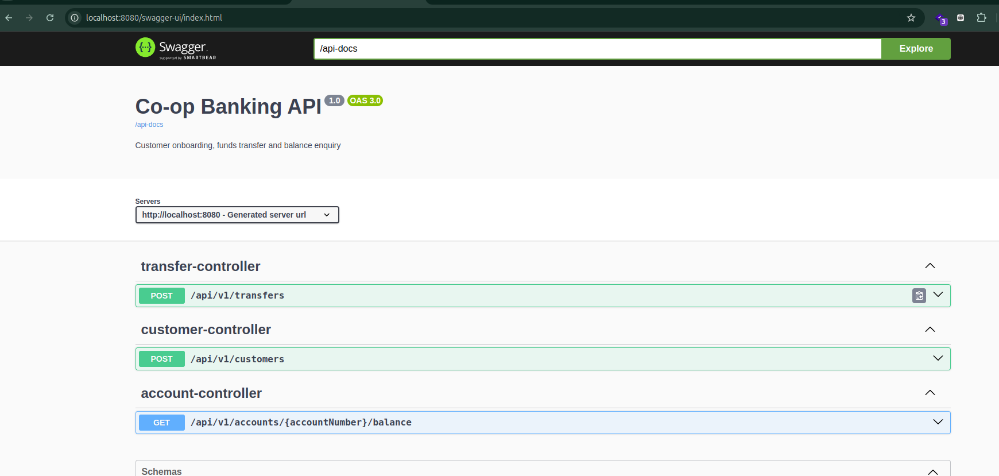
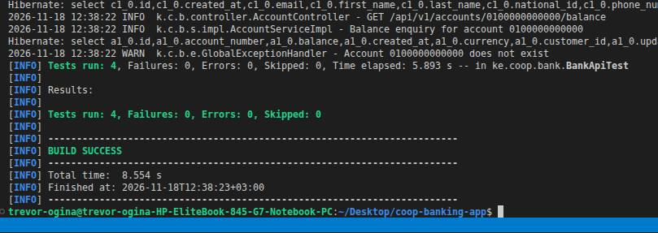
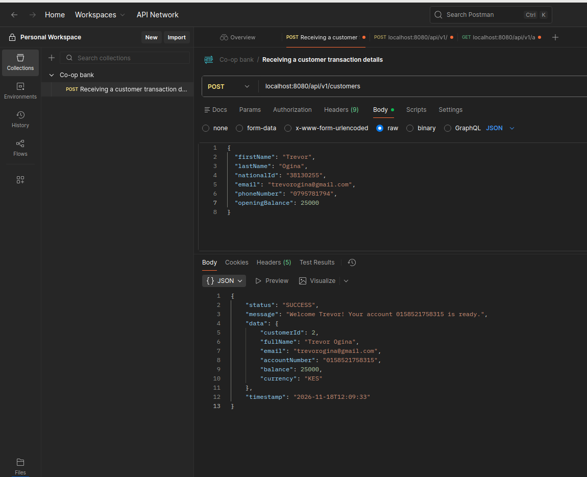
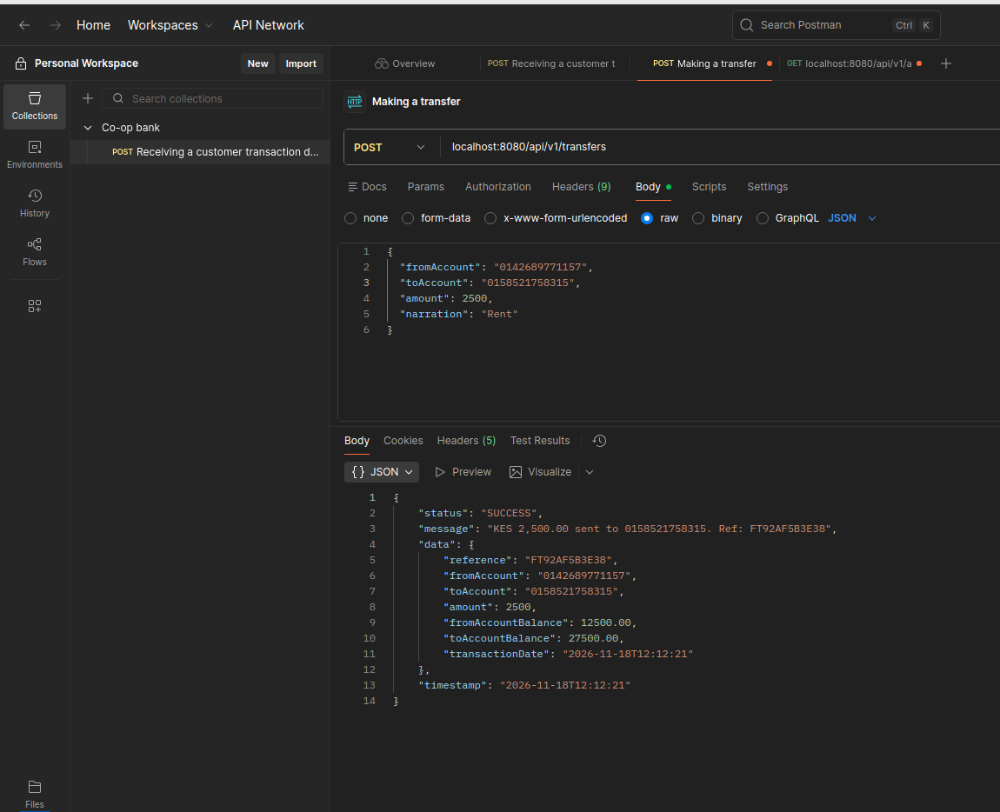
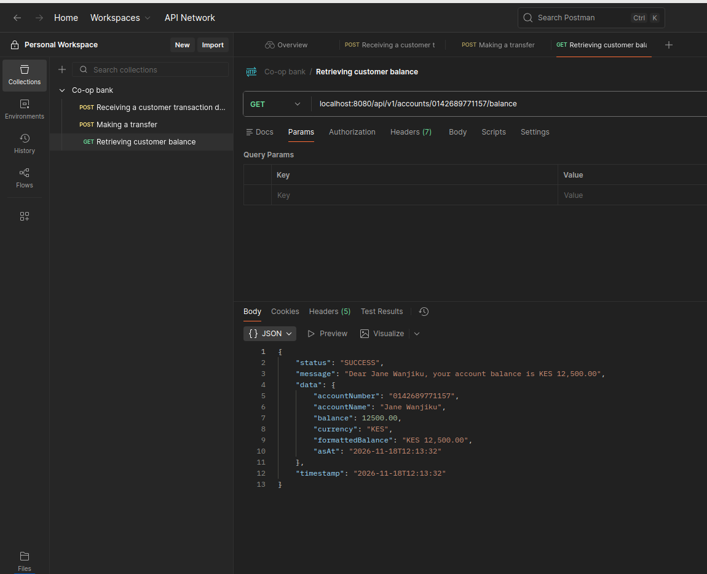

# Co-op Banking App

Spring Boot API for creating customers, transferring funds and checking balances.

## Run

```bash
./mvnw spring-boot:run
```

Runs on `http://localhost:8080`. Swagger: http://localhost:8080/swagger-ui.html



Tests: `./mvnw test`



## APIs

### 1. Create customer
`POST /api/v1/customers`

```json
{
  "firstName": "Jane",
  "lastName": "Wanjiku",
  "nationalId": "12345678",
  "email": "jane@example.com",
  "phoneNumber": "0712345678",
  "openingBalance": 15000
}
```

- all fields required except phone number
- national ID: 7 or 8 digits, must be unique
- email must be unique
- phone: Kenyan format (07.., 01.. or +254..)
- opening balance can't be negative

Returns `201` with the new account number.

### 2. Transfer funds
`POST /api/v1/transfers`

```json
{
  "fromAccount": "0149895421023",
  "toAccount": "0194624317827",
  "amount": 2500,
  "narration": "Rent"
}
```

- both accounts must exist and be different
- minimum amount is 1
- sender must have enough balance
- narration is optional

Returns `200` with the transaction reference and both new balances.

### 3. Balance enquiry
`GET /api/v1/accounts/{accountNumber}/balance`

- account number must be 13 digits

Returns `200`:

```json
{
  "status": "SUCCESS",
  "message": "Dear Jane Wanjiku, your account balance is KES 12,500.00",
  "data": {
    "accountNumber": "0149895421023",
    "accountName": "Jane Wanjiku",
    "balance": 12500.00,
    "currency": "KES",
    "formattedBalance": "KES 12,500.00",
    "asAt": "2026-11-18T11:24:22"
  },
  "timestamp": "2026-11-18T11:24:22"
}
```

## Postman screenshots

**Create customer**



**Transfer**



**Balance enquiry**



## Errors

| Status | When |
|---|---|
| 400 | validation error, bad json, same account, duplicate customer |
| 404 | account not found |
| 422 | insufficient funds |
| 500 | unexpected error |
